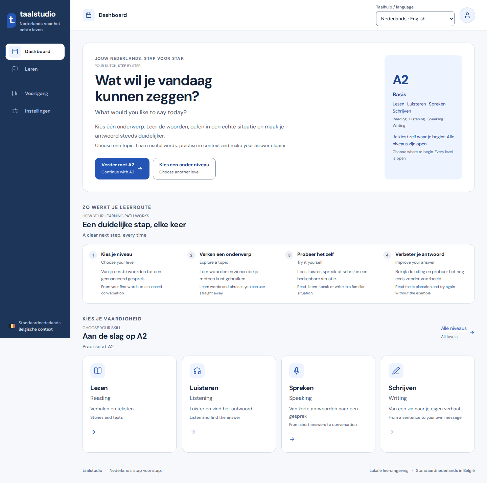

# Taalstudio

**Belgian Dutch for the conversations that matter.**

I'm building Taalstudio as a personal language-learning workspace: read something useful, listen for the
important detail, say what you need, and write a clear response. Vocabulary and grammar support those tasks.


[Try the interactive preview](https://taalstudio-learning-preview.nimaa-asadii.chatgpt.site) ·
[Learning and exam references](docs/BELGIAN_ALIGNMENT.md) ·
[Architecture](docs/ENGINEERING.md) · [Release guide](docs/GO_LIVE.md)

[Preview source and local instructions](demo/README.md).

The preview is private to the project owner and uses browser-local sample interactions. It demonstrates
the proposed learning experience; it is not the Azure deployment and makes no live model or speech calls.

## Start here

| I want to… | Read or open |
| --- | --- |
| Run the app on my laptop | [Local setup](#run-locally) |
| Understand the learning experience | [What I can practise](#what-i-can-practise) |
| Check the level and exam references | [Belgian alignment](docs/BELGIAN_ALIGNMENT.md) |
| Verify code before a release | [Checks](#checks) and [verification guide](docs/VERIFICATION.md) |
| Release to Azure | [GO_LIVE](docs/GO_LIVE.md) |

## What I can practise

The main navigation has five destinations: **Vandaag**, **Leren**, **Verhalen**, **Spreken** and **Woorden**.
Progress and settings sit alongside them, keeping everyday practice easy to find.

- **Vandaag:** an episode, words due for spaced review, and the next useful activity. Points recognise
  practice effort; they are not a judgement of language ability.
- **Leren:** twelve open stages, four skills, grammar practice, vocabulary cards, short stories and a
  separate four-skill final check. Every stage has a word bank of at least 500 entries, 100 stories and
  100 topics per skill. These are coverage counts, not proof that the content is correctly calibrated.
- **Verhalen:** the continuing story *De Lindestraat*, comprehension activities, optional support and
  labelled synthetic audio. Choices shape later episodes. Video lessons are a separate optional feature.
- **Spreken:** practical missions about changing an appointment, ordering lunch, returning a purchase
  and contacting a course. The character's facts and valid arrangements are enforced by code.
  Push-to-talk has a labelled typed fallback; typed answers do not count as spoken evidence.
- **Woorden:** save words encountered in context and revisit them with spaced practice.

Dutch stays the practice language. English and Persian support can be selected in the header; learning
text follows that choice. Interface Persian is activated in reviewed batches, so unreviewed interface
translations may remain hidden. Audio controls use the configured voice and identify synthetic speech.

Writing feedback points to the learner's actual draft, suggests a corrected form and explains the
change. The draft stays available for revision. Feedback, assistance and later independent performance
must remain distinguishable.

The connected learning sequence is **meet a word → understand it in a story → hear it → use it in
different situations → revise → return without help**. New units use ten explicit story lines with
parallel Dutch, English and Persian text, sentence playback, and related four-skill activities. The
tasks progress from naming concrete things at pre-A1 to interpreting viewpoints and register at C2.
In Story Time, **Verhaal naar gesprek** opens the new ten-line collection first. Stories include a
comprehension question, sentence playback and a level-specific invitation to retell, discuss or rewrite.
The original connected units also open their related four-skill activities. In the word library,
**Oefen de 150 kernwoorden** selects the productive core: a mix of nouns, verbs, adjectives, adverbs,
interaction phrases and function words, with three authored usage examples per entry. The wider word
bank remains available. Forms are contextual examples, not automatically guessed conjugations.

The current authored inventory is shown below. Each core entry has three trilingual context examples;
these inventories are provisional until language review, not a claim of CEFR certification.

| Stage | Productive core | Authored stories | Story target |
| --- | ---: | ---: | ---: |
| Pre-A1 | 150 | 52 | 200 |
| A1 | 150 | 35 | 200 |
| pre-A2 | 150 | 27 | 200 |
| A2 | 150 | 22 | 200 |
| pre-B1 | 150 | 18 | 200 |
| B1 | 150 | 48 | 200 |
| pre-B2 | 150 | 11 | 200 |
| B2 | 150 | 7 | 200 |
| pre-C1 | 150 | 14 | 200 |
| C1 | 150 | 15 | 200 |
| pre-C2 | 150 | 21 | 200 |
| C2 | 150 | 15 | 200 |

The editorial target is **200 distinct 8–12-line stories per stage**, without reusing a plot at another
stage. The inventory audit reports the exact current shortfall; a new title or changed name does not
make a repeated plot distinct. Older story banks remain accessible and include repeated plots; they do
not meet the new standard merely because they have a different stage ID. Existing banks retain at
least 500 words. Authored content and translations still need competent Belgian Dutch, English and Persian
review; neither an automated structural check nor a word count establishes language accuracy.

New stories are original modern fiction. Everyday domains come from Belgian public-service resources;
historical literary motifs are referenced only with edition-specific public-domain checks. No news
articles, TV transcripts or textbook pages are bundled. The [source registry](content/alignment/source-registry.json)
records the permitted role of each resource, and [story provenance](content/alignment/story-provenance.json)
records the source family and plot synopsis without claiming external endorsement. Wablieft and NedBox
remain external reading/listening resources, rather than content to copy into the app.

Current authored inventory (legacy stories excluded):

| Stage | Productive core | Authored stories / 200 |
| --- | ---: | ---: |
| Pre-A1 | 150 | 42 |
| A1 | 150 | 15 |
| Pre-A2 | 150 | 27 |
| A2 | 150 | 22 |
| Pre-B1 | 150 | 18 |
| B1 | 150 | 48 |
| Pre-B2 | 150 | 11 |
| B2 | 150 | 7 |
| Pre-C1 | 150 | 14 |
| C1 | 150 | 15 |
| Pre-C2 | 150 | 21 |
| C2 | 150 | 15 |

These are authored entries, with language review pending. They are not certified level inventories.

To rebuild the authored expansion and inspect its actual coverage:

```bash
python scripts/content_build/vocabulary_transfer.py
python scripts/validate_story_quality.py --require-targets
```

The target check intentionally fails while any stage lacks 200 eligible authored stories or a complete
150-word productive core. It is separate from software tests and never grants assessment credit.

The supplied Dutch scans now support **Van woord naar gesprek**: twelve original units from pre-A1 to
B1, connecting new Story Time stories with reading, listening, speaking, writing and grammar practice.
Each stage has two connected units: introductions and classroom details, times and locations, preferences
and requests, everyday problems and messages, linked events and negotiations. Listening introduces
new information that the learner uses in speaking or writing.
The existing banks and progress stay intact. The new language and level assignments still need native
review; raw scans and OCR remain private. [What was added and where to find it](docs/SOURCE_LESSONS.md).



## Levels and exam preparation

The course follows this sequence:

**Pre-A1 → A1 → pre-A2 → A2 → pre-B1 → B1 → pre-B2 → B2 → pre-C1 → C1 → pre-C2 → C2**

A1–C2 are CEFR levels. Pre-A1 is a descriptor band in the CEFR Companion volume. The other `pre-` stages
are internal bridges, not extra official levels. There is no A3. Flemish NT2 references run from
Breakthrough/1.1 and Waystage/1.2 through richtgraden 2, 3 and 4; C2 needs a separately reviewed extension.

The new **“Wat oefen je op dit niveau?”** panel connects each skill to a sourced learning target. The
**Examenwijzer** at `/examens` distinguishes CNaVT profiles, ITNA and other Belgian readiness routes and
links to their official information. It does not turn the existing exercises into official mock papers.
ITNA and CNaVT have different formats; a generic four-part score should not pretend to reproduce both.

Reading, listening, speaking and writing keep separate records. A stage check is provisional practice
evidence. It does not award a recognised certificate, determine a person's official CEFR level or
predict an official examination result. All stages remain accessible.

See [the complete reference map](docs/BELGIAN_ALIGNMENT.md),
[versioned learning targets](content/alignment/levels.json) and
[exam readiness blueprints](content/alignment/exams.json).

## Quality I am working toward

I want practice to show whether someone can communicate independently in a different situation later,
not only whether they can repeat a corrected sentence immediately.

The next learning experiments are deliberately small:

1. **Return in a new context:** revisit a useful function after a delay with changed facts.
2. **Repair a misunderstanding:** notice a wrong detail, clarify it and confirm a workable outcome.
3. **Listen before revealing:** make an initial interpretation, replay, then revise; transcripts and
   translations are available on request and count as support.

These are research-informed directions, not proven outcomes for this product. The preview demonstrates
them with fixtures. Production evidence and broader activation still need learner trials and language
review. [Research and limitations](docs/LEARNING_RESEARCH.md) explain the decisions.

Existing fixed banks remain labelled **unreviewed**. Shared words can support spiral practice, but a
reused whole passage is review, not fresh coverage of a higher level. The content audit reports hashes
and repeated reading/listening texts without claiming to classify their CEFR difficulty:

```bash
python scripts/audit_learning_content.py --json .local/content-audit.json
python scripts/validate_story_quality.py --json .local/story-quality.json
```

The story audit distinguishes authored lines from legacy passages, reports duplicates and translation
fact checks, and measures the remaining inventory. `--require-targets` exits unsuccessfully until the
requested inventory is present. Neither audit certifies natural language, CEFR difficulty or translation
accuracy. To rebuild the versioned connected units after editing their authored source:

```bash
python -m scripts.content_build.learning_units
python -m scripts.content_build.vocabulary_transfer
```

A small native-review pilot starts with one mission and one A2 topic. Reviews must identify the reviewer,
date and exact content hash. [Review form](docs/CONTENT_REVIEW_FORM.md).

## Run locally

Use Docker Desktop with WSL integration, Ollama, and either the conda environment below or Python 3.11+,
Node 22+ and ffmpeg. No Azure account is needed for local providers.

```bash
conda env create -f environment.yml
conda activate dlp
ollama pull llama3.1:8b
python scripts/run.py setup
```

`setup` creates `.env` from the example when it is absent. Configure `DEV_OWNER_EMAIL`, `OWNER_ALLOWLIST`,
`ASSERTION_SIGNING_KEY` (at least 32 random characters), and `LOCAL_CHAT_MODEL` in that local file.
Keep credentials out of Git; private parameters, source scans and work files stay on the laptop.

```bash
python scripts/run.py services
python scripts/run.py migrate
python scripts/run.py fixture
python scripts/fetch_piper_voice.py
python scripts/run.py preflight
python scripts/run.py dev
```

Open **http://localhost:3000**. On later starts, `python scripts/run.py dev` brings up the local services,
applies migrations, loads content and starts the web/API processes. The first local episode may take
one to three minutes on a laptop CPU. A development route can compile slowly when the checkout is on
WSL's `/mnt/c`; that is separate from production performance.

For WSL, enable your distribution under Docker Desktop → Settings → Resources → WSL integration.
Keep `.env` comments on their own lines. Use the preflight report to distinguish configured adapters
from actually reachable services; fixture results never establish live Azure success.

## Architecture

| Component | Local | Azure |
| --- | --- | --- |
| Web: Next.js, React, TypeScript | Laptop | Container App; only public origin, built-in sign-in |
| API: FastAPI, Pydantic, SQLAlchemy | Laptop | Internal Container App behind the signed web proxy |
| Database | PostgreSQL 16 in Docker | PostgreSQL Flexible Server |
| Files and audio | Azurite/local providers | Private Blob Storage |
| Language model | Ollama | Configured usage-based Azure deployment |
| Speech | faster-whisper and Piper | Azure Speech, Belgian Dutch recognition and voices |
| Background work | PostgreSQL jobs, in-process worker | Same job contract; leases and schema compatibility guard |
| Operations | Local checks | Key Vault, managed identities, Application Insights, Bicep |

External services sit behind narrow provider interfaces. Models propose language and feedback;
application code controls permissions, usage limits, submissions, scenario facts and completion.
The existing linear LangGraph workflows remain until a reviewed replacement justifies changing them.
There is no new orchestration framework in this upgrade.

Azure model requests make one attempt per dispatch. Paid reservations and settlements survive the
calling transaction's rollback; potentially billed failures retain conservative allowance consumption.
Workers check the packaged migration head before claiming work, renew their lease and reject stale
completion. These are release safeguards, not a substitute for draining active jobs before migration.

## Checks

```bash
python scripts/run.py test
python scripts/run.py e2e
python scripts/run.py e2e-visual
cd apps/web
npm run test:unit
npm run test:component
npm run typecheck
npm run typecheck:tests
npm run lint
npm run format:check
```

API integration tests require a PostgreSQL database whose name ends in `_test`; destructive cleanup
refuses the learner database. CI runs PostgreSQL tests, web checks, functional browser journeys,
pinned-renderer screenshot comparisons and production container builds. The populated migration test
uses an isolated schema to check data preservation through 0008–0010.

CI does not verify live model quality, microphone behaviour on the actual phone, native language review
or backup restoration. Those remain explicit release checks.

## Deploying to Azure

[GO_LIVE](docs/GO_LIVE.md) contains the service and identity setup, image build, migration and release steps.
`scripts/deploy_current.sh` requires passing push-event CI on the exact commit; deployment is manual.
Before migrating, record the current images and migration head and drain active jobs and renders.
A successful GitHub commit or fixture test is not proof that Azure has been updated.

Paid use requires deliberate approval and configured limits. Azure budgets alert; they do not stop
billing. Hosting and database costs continue even when paid inference is disabled.

## Documentation

- **Current work:** [Review decisions](docs/REVIEW_DECISIONS.md), [status](docs/STATUS.md), [roadmap](docs/ROADMAP.md).
- **Learning:** [Belgian alignment](docs/BELGIAN_ALIGNMENT.md), [research](docs/LEARNING_RESEARCH.md),
  [curriculum](docs/CURRICULUM.md), [topics](docs/TOPIC_PRACTICE.md), [source coverage](docs/SOURCE_COVERAGE.md).
- **Engineering:** [architecture and conventions](docs/ENGINEERING.md), [decisions](docs/DECISIONS.md),
  [verification](docs/VERIFICATION.md), [release guide](docs/GO_LIVE.md).
- **Experiences:** [story engine](docs/STORY_ENGINE.md), [video lessons](docs/VIDEO_LESSONS.md),
  [review walkthrough](docs/DEMO.md).
