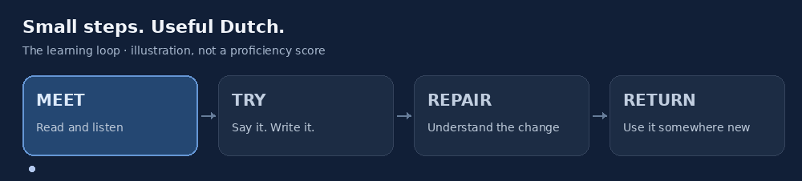

# Taalstudio

**Belgian Dutch for the conversations that matter.**

I’m building Taalstudio around a simple learning sequence: meet useful words, understand them in a
connected situation, hear them, use them, and improve your answer.



## Find your next activity

**Dashboard → choose a level → choose a skill → choose a topic.**

The main menu contains **Dashboard**, **Leren**, **Voortgang** and **Instellingen**. Within Leren,
every level uses the same four skills. Vocabulary and grammar stay beside the activity; stories are
part of Reading. Old word, story and speaking bookmarks lead into the same workspace.

| Skill | How practice works |
| --- | --- |
| Reading | Prepare vocabulary and grammar, read a coherent story with sentence audio, check understanding, then retell it. |
| Listening | Follow a continuous situation in three sections: complete gaps, choose answers, and write short answers. Reveal the transcript when needed. |
| Speaking | Answer short questions, give a description, then develop an opinion. Reveal model answers on demand, record or type, and review your wording. |
| Writing | Start with a short response, then develop a longer message for a purpose. Feedback shows the original fragment, a correction and an explanation. |

Each topic has **Prepare → Practise → Try it yourself** steps. The word reference is searchable and
compact, with replay for Dutch words and examples. Saved-word review and personal episodes remain
available as nested tools. Audio is generated only after an explicit action; video generation is disabled.

Choose **Dutch** or **Dutch + English** in the header. Dutch remains the practice language. Existing
Persian source fields are preserved for data compatibility but do not appear in the learner interface.

New guided-practice responses, transcripts and scores are temporary. They disappear when the activity
is left or reloaded and do not count toward saved progress. Short-answer variants that cannot be checked
reliably are left unscored. Typed text and transcripts never receive a pronunciation grade. Local fixture
providers demonstrate the interaction without claiming to provide real speech or assessed language feedback.

## Levels and content

**Pre-A1 → A1 → pre-A2 → A2 → pre-B1 → B1 → pre-B2 → B2 → pre-C1 → C1 → pre-C2 → C2**

All stages are open. A1–C2 are CEFR levels; Pre-A1 has CEFR descriptors. The other pre-stages are internal
bridges. Early tasks use letters, numbers, time, introductions and directions. Later tasks build toward
connected explanations, professional communication, argument, nuance and academic work.

The guided catalogue has **100 topic categories** and at least **50 available topics for each skill in
every stage**, backed by actual activities. The twelve packs contain **600 guided topic lessons**,
including existing original material surfaced with its source identity. Each reading has 8–12 connected
Dutch lines, parallel English support and grounded comprehension questions. These are activities,
not 600 independently reviewed texts.

Existing stage libraries retain 500+ word entries and 150-word productive cores. Each stage also has
100 additional original grammar questions in ten manageable rounds, alongside its earlier exercises.
The separate editorial target of 200 distinct, reviewed stories per stage remains unfinished. Structural
checks verify coverage and answer integrity; they cannot certify natural language, translation quality
or CEFR placement. Content remains labelled as awaiting specialist language review.

IELTS preparation resources inform the task patterns, not the language being taught or an examination
claim. Stories, prompts and examples are original; commercial exam passages and audio are not copied.
[Belgian level and exam references](docs/BELGIAN_ALIGNMENT.md) explain the NT2, ITNA and CNaVT context.

Validate the guided catalogue after content edits:

```bash
python scripts/audit_guided_study.py --write-index
python scripts/validate_story_quality.py --require-targets
```

The second command intentionally fails until the larger story target is met. Neither command grants
assessment credit or establishes language accuracy.

## Run locally

Use Docker Desktop with WSL integration, Ollama, and either the conda environment below or Python 3.11+,
Node 22+ and ffmpeg. No Azure account is needed for local providers.

```bash
conda env create -f environment.yml
conda activate dlp
ollama pull llama3.1:8b
python scripts/run.py setup
```

`setup` creates `.env` from the example when it is absent. Configure `DEV_OWNER_EMAIL`, `OWNER_ALLOWLIST`,
`ASSERTION_SIGNING_KEY` (at least 32 random characters), and `LOCAL_CHAT_MODEL` in that local file.
Keep credentials out of Git; private parameters, source scans and work files stay on the laptop.

```bash
python scripts/run.py services
python scripts/run.py migrate
python scripts/run.py fixture
python scripts/fetch_piper_voice.py
python scripts/run.py preflight
python scripts/run.py dev
```

Open **http://localhost:3000**. On later starts, `python scripts/run.py dev` brings up the local services,
applies migrations, loads content and starts the web/API processes. The first local episode may take
one to three minutes on a laptop CPU. A development route can compile slowly when the checkout is on
WSL's `/mnt/c`; that is separate from production performance.

For WSL, enable your distribution under Docker Desktop → Settings → Resources → WSL integration.
Keep `.env` comments on their own lines. Use the preflight report to distinguish configured adapters
from actually reachable services; fixture results never establish live Azure success.

## Architecture

| Component                          | Local                              | Azure                                                      |
| ---------------------------------- | ---------------------------------- | ---------------------------------------------------------- |
| Web: Next.js, React, TypeScript    | Laptop                             | Container App; only public origin, built-in sign-in        |
| API: FastAPI, Pydantic, SQLAlchemy | Laptop                             | Internal Container App behind the signed web proxy         |
| Database                           | PostgreSQL 16 in Docker            | PostgreSQL Flexible Server                                 |
| Files and audio                    | Azurite/local providers            | Private Blob Storage                                       |
| Language model                     | Ollama                             | Configured usage-based Azure deployment                    |
| Speech                             | faster-whisper and Piper           | Azure Speech, Belgian Dutch recognition and voices         |
| Background work                    | PostgreSQL jobs, in-process worker | Same job contract; leases and schema compatibility guard   |
| Operations                         | Local checks                       | Key Vault, managed identities, Application Insights, Bicep |

External services sit behind narrow provider interfaces. Models propose language and feedback;
application code controls permissions, usage limits, submissions, scenario facts and completion.
The existing linear LangGraph workflows remain until a reviewed replacement justifies changing them.
There is no new orchestration framework in this upgrade.

Azure model requests make one attempt per dispatch. Paid reservations and settlements survive the
calling transaction's rollback; potentially billed failures retain conservative allowance consumption.
Workers check the packaged migration head before claiming work, renew their lease and reject stale
completion. These are release safeguards, not a substitute for draining active jobs before migration.

## Checks

```bash
python scripts/run.py test
python scripts/run.py e2e
python scripts/run.py e2e-visual
cd apps/web
npm run test:unit
npm run test:component
npm run typecheck
npm run typecheck:tests
npm run lint
npm run format:check
```

API integration tests require a PostgreSQL database whose name ends in `_test`; destructive cleanup
refuses the learner database. CI runs PostgreSQL tests, web checks, functional browser journeys,
pinned-renderer screenshot comparisons and production container builds. The populated migration test
uses an isolated schema to check data preservation through 0008–0010.

CI does not verify live model quality, microphone behaviour on the actual phone, native language review
or backup restoration. Those remain explicit release checks.

## Deploying to Azure

[GO_LIVE](docs/GO_LIVE.md) contains the service and identity setup, image build, migration and release steps.
`scripts/deploy_current.sh` requires passing push-event CI on the exact commit; deployment is manual.
Before migrating, record the current images and migration head and drain active jobs and renders.
A successful GitHub commit or fixture test is not proof that Azure has been updated.

Paid use requires deliberate approval and configured limits. Azure budgets alert; they do not stop
billing. Hosting and database costs continue even when paid inference is disabled.
